# Beyond Bitcoin

## Table of contents

- [1. Smart contracts](#1-smart-contracts)
    - [1.1. Contracts](#11-contracts)
    - [1.2. Szabo's definition](#12-szabos-definition)
- [2. Ethereum](#2-ethereum)
    - [2.1. A programmable blockchain](#21-a-programmable-blockchain)
    - [2.2. A name registry](#22-a-name-registry)
    - [2.3. Gas](#23-gas)
    - [2.4. Proof of stake](#24-proof-of-stake)
- [3. Myths and misconceptions](#3-myths-and-misconceptions)
    - [3.1. Cryptocurrencies for payments](#31-cryptocurrencies-for-payments)
    - [3.2. Selfish mining](#32-selfish-mining)
    - [3.3. The DAO](#33-the-dao)
    - [3.4. Who do you trust?](#34-who-do-you-trust)
    - [3.5. Energy](#35-energy)
    - [3.6. ASIC-resistant hash puzzles](#36-asic-resistant-hash-puzzles)
- [4. Wrap-up](#4-wrap-up)
    - [4.1. What is a blockchain?](#41-what-is-a-blockchain)
    - [4.2. Permissionless and permissioned](#42-permissionless-and-permissioned)
    - [4.3. Consensus models](#43-consensus-models)
- [Glossary](#glossary)
- [Bibliography](#bibliography)
- [Licenses](#licenses)

## 1. Smart contracts

### 1.1. Contracts

> [!info] Contract
> A promise or performance given in exchange for a promise or performance.

> [!info] Smart contract (Szabo, 1996)
> A set of promises, specified in digital form, including protocols within which the parties perform on these promises.

> [!example]
> A vending machine is a mechanical smart contract. It enforces an agreement between you and the owner of the vending machine about the purchase of a candy bar.

### 1.2. Szabo's definition

Each part of the definition has a precise meaning

| Part                               | Meaning                                                                      |
| ---------------------------------- | ---------------------------------------------------------------------------- |
| "A set of promises"                | Contractual terms or rule-based operations to carry out (business logic)     |
| "Specified in digital form"        | The contract operates electronically and consists of lines of code           |
| "Protocols"                        | An algorithm, that is, a set of rules for how each party should process data |
| "Within which the parties perform" | Performance is automated and traditionally regarded as irrevocable           |

## 2. Ethereum

### 2.1. A programmable blockchain

In 2014, Vitalik Buterin proposed Ethereum, a blockchain with a built-in Turing-complete programming language that can be used to create "contracts".

Ethereum uses the same [cryptographic building blocks](building-blocks.md) as Bitcoin, but with

- An [account-based ledger](bitcoin.md#11-account-based-ledger)
- Proof of stake, since 2022 (see [§2.4](#24-proof-of-stake))

---

> [!info] Turing-complete machine
> A Turing-complete machine given
> - Enough time and memory
> - The necessary instructions
>
> can solve any computational problem, no matter how complex.

> [!info] Smart contract (Ethereum, 2014)
> A program that lives on the blockchain.

---

A smart contract

- Is uploaded as program code in a special transaction
- Moves digital assets based on pre-specified rules (if-then statements)

While living on the blockchain, a smart contract

- Has its own internal state
- Exposes functions that anyone can call by sending a transaction
- Unlocks its value if certain conditions are met

### 2.2. A name registry

> [!example]
> A smart contract that lets anyone claim a name by paying a small fee.

```solidity
contract NameRegistry {
    mapping(bytes32 => address) public registryTable;

    function claimName(bytes32 name) public payable {
        require(msg.value >= 10, "insufficient funds");
        if (registryTable[name] == address(0)) {
            registryTable[name] = msg.sender;
        }
    }
}
```

where `msg` holds the data of the transaction that calls the function, e.g., the caller (`msg.sender`) and the amount sent (`msg.value`).

---

| Code                                               | What it does                                                                                                        | Smart contract property                |
| -------------------------------------------------- | ------------------------------------------------------------------------------------------------------------------- | -------------------------------------- |
| `mapping(bytes32 => address) public registryTable` | `registryTable` maps 32-byte strings to public keys                                                                 | Has its own internal state             |
| `function claimName(bytes32 name) public payable`  | `claimName` defines an entry point that accepts a single argument, `name`, and can receive coins                    | Exposes functions that anyone can call |
| `require(msg.value >= 10, "insufficient funds")`   | Makes sure the caller has sent at least 10 wei ($1 \text{ ETH} = 10^{18}$ wei). Otherwise, terminates with an error | Condition to be met                    |
| `if (registryTable[name] == address(0))`           | Makes sure `name` has not already been taken                                                                        | Condition to be met                    |
| `registryTable[name] = msg.sender`                 | Assigns `name` to the caller                                                                                        | Unlocks its value                      |

### 2.3. Gas

A Turing-complete language has loops. And loops can run forever...

```solidity
while (true) {
    i += 1;
}
```

Every node runs every transaction, so a loop that runs forever would stall the Ethereum network.

> [!question] How can we prevent loops from running forever?

---

> [!info] Gas
> Each instruction costs a fixed amount of gas. The sender of a transaction pays for gas in ETH.

| Operation                                                | Cost (gas) |
| -------------------------------------------------------- | ---------- |
| Addition                                                 | 3          |
| Writing a word to the internal state of a smart contract | 20,000     |
| Every transaction                                        | 21,000     |

A loop that runs forever eventually runs out of gas.

---

The fee of a transaction is

$$\text{fee} = \text{gas used} \times (\text{base fee} + \text{priority fee})$$

where

- $\text{gas used}$: amount of gas that the transaction actually uses
- $\text{base fee}$: amount of ETH per unit of gas set by the protocol
- $\text{priority fee}$: amount of ETH per unit of gas that the sender offers to the node that proposes the block

The sender also sets the maximum amount of gas that the transaction can use.

---

> [!warning]
> If the transaction runs out of gas, all state changes revert, but the fee is still paid.

> [!note]
> The $\text{gas used} \times \text{base fee}$ part of the fee is destroyed. This prevents the node that proposes a block from
> - Filling it with its own transactions for free, to raise the base fee that others pay later
> - Secretly refunding part of it to users, to offer them a lower price than the protocol

### 2.4. Proof of stake

Proof-of-work mining has an unnecessary step

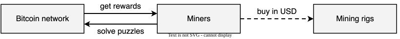

Miners spend money (e.g., USD) on mining rigs, which solve hash puzzles to get rewards.

> [!question] Who could take control of Bitcoin with a [51% attack](bitcoin.md#52-mining)?

---

> [!warning] Bitcoin economy $\ll$ world economy
> Anyone with a lot of wealth outside Bitcoin could buy enough mining rigs to take control of Bitcoin.

If the attacker could only use their wealth within the Bitcoin economy, they would have to buy 51% of all BTC. This would likely raise the price of BTC, so the cost of 51% of all BTC would (arguably) be much higher than the cost of 51% of the mining rigs.

---

> [!info] Proof of stake
> Nodes lock up (stake) ETH to get the right to propose blocks and vote on them. If they behave dishonestly, part of their stake is destroyed.

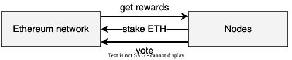

Proof of stake is a form of virtual mining. Instead of spending money on mining rigs, nodes put their money directly into the system as a stake.

---

On 15 September 2022, Ethereum switched from proof of work to proof of stake, an event known as the merge.

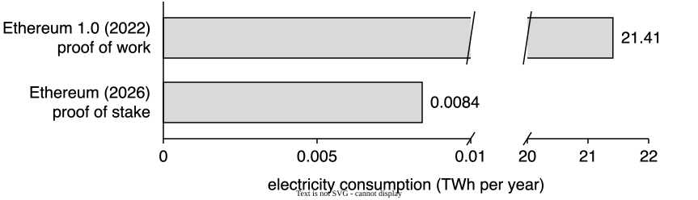

The merge cut the electricity consumption of Ethereum by about 99.99%, from about 21 TWh per year to less than 0.01 TWh per year.

## 3. Myths and misconceptions

### 3.1. Cryptocurrencies for payments

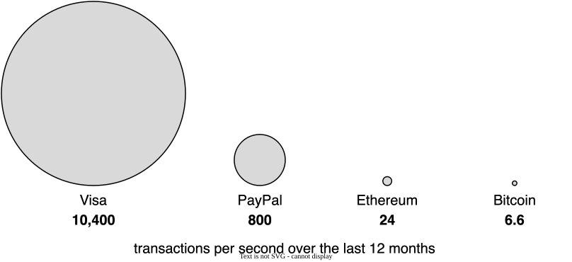

> [!warning] Not fit for purpose: too few transactions per second
> Cryptocurrencies process far fewer transactions per second than traditional payment systems.

---

BTC has a fixed monetary policy, with a creation rate designed to be [deflationary](bitcoin.md#42-block-reward).

> [!example]
> On 22 May 2010, Laszlo Hanyecz paid 10,000 BTC for two pizzas, worth about 41 USD at the time. In May 2025, those coins were worth about 1.1 billion USD.

> [!warning] Not fit for purpose: deflationary
> The only rational behavior is to never spend a deflationary currency. Otherwise, eternal regret.

### 3.2. Selfish mining

Conventional wisdom says that the Bitcoin mining protocol is

- Equitable to its participants: the probability that a miner wins the next block equals its fraction of the global [hash power](bitcoin.md#5-proof-of-work)
- Secure against an attacker that controls less than 50% of the hash power ([security assumption](bitcoin.md#52-mining))

---

Empirical evidence shows that miners behave strategically.

Rewards are distributed at infrequent, random intervals, so miners form mining pools to decrease the variance of rewards.

> [!info] Mining pool
> A group of miners that all contribute to the solution of hash puzzles and share the rewards in proportion to their contributions.

---

> [!example]
> A selfish pool finds two blocks in a row and keeps them secret, so that the chain forks.

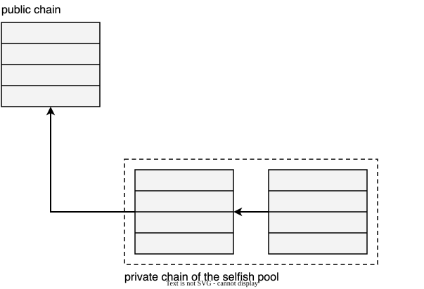

---

> [!example]
> Then, honest nodes extend the public chain, which now approaches the private one in length. So, the selfish pool reveals its blocks.

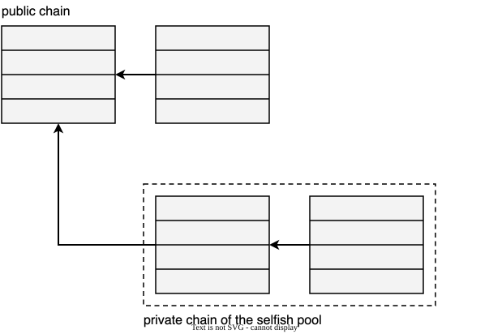

---

> [!example]
> Then, the revealed chain is the longest, so honest nodes switch to it ([policy](bitcoin.md#33-double-spending)), and their block becomes a stale block.

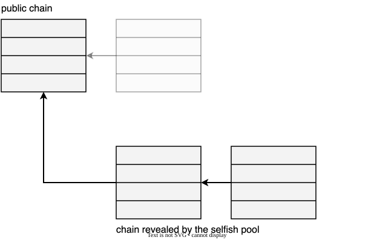

---

> [!warning] Majority is not enough
> Above a certain size, the rewards of the selfish pool exceed its share of the hash power.
>
> This incentivizes rational miners to join the selfish pool, which quickly grows towards a majority.
>
> A selfish pool with more than 1/3 of the hash power always earns more than its share, so at least 2/3 of the hash power must be honest, not just the majority.

### 3.3. The DAO

The DAO (Decentralized Autonomous Organization) was an investment fund set up in 2016

- Managed entirely by smart contracts, with no direct human administration
- Investors could vote on how the funds would be invested

---

Pseudocode of a DAO-like contract

```
function withdraw(uint amount) {
    client = msg.sender;
    if (balance[client] >= amount) {
        if (client.sendMoney(amount))
            balance[client] -= amount;
    }
}
```

---

Pseudocode of a DAO-like exploit

```
function sendMoney(uint amount) {
    victim = msg.sender;
    balance += amount;
    victim.withdraw(amount);
}
```

> [!question] What is wrong with `withdraw`?

---

> [!bug]
> 1. `withdraw` sends the money to the client with an external call, `client.sendMoney(amount)`
> 2. `sendMoney` of the attacker immediately calls `withdraw` again (re-entrant call)
> 3. The check `balance[client] >= amount` passes again, because the balance has not been decremented yet
>
> The money is sent again and again, until the call stack overflows. In June 2016, someone exploited this flaw to steal about 50M USD from the DAO. In July 2016, a hard fork moved about 12M ETH from the DAO contracts to a recovery contract, from which investors could take their ETH back.

---

> [!tip] Fix
> Decrement the balance before sending the money.

```
function withdraw(uint amount) {
    client = msg.sender;
    if (balance[client] >= amount) {
        balance[client] -= amount;
        client.sendMoney(amount);
    }
}
```

---

> [!warning] Smart contracts need a concurrency model
> Transactions run one at a time. Naively, one may conclude that smart contracts are unaffected by concurrency.
>
> However, when a smart contract calls another smart contract, the callee can call back before the caller has finished. The caller then has two runs of the same function in progress, as with two threads.
>
> The DAO bug is a classic concurrency bug, easy to spot for anyone familiar with concurrent programming.

### 3.4. Who do you trust?

Bitcoin was proposed as a payment system [based on cryptographic proof instead of trust](building-blocks.md#14-nakamotos-ambition). However, trust has to happen somewhere.

> [!example]
> The DAO bug (see [§3.3](#33-the-dao)) was in the code. To fix it, the community agreed on a hard fork, which is a new version of the software written by its developers.

> [!warning] Blockchains are not trustless
> You trust the code, the people who maintain it, and the community.

### 3.5. Energy

Bitcoin uses an estimated 146 TWh of electricity per year (between 78 and 270 TWh), about 0.57% of all the electricity consumed in the world

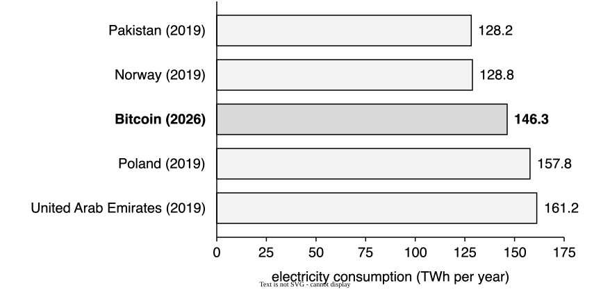

---

Proof of stake uses a tiny fraction of that electricity (see [§2.4](#24-proof-of-stake))

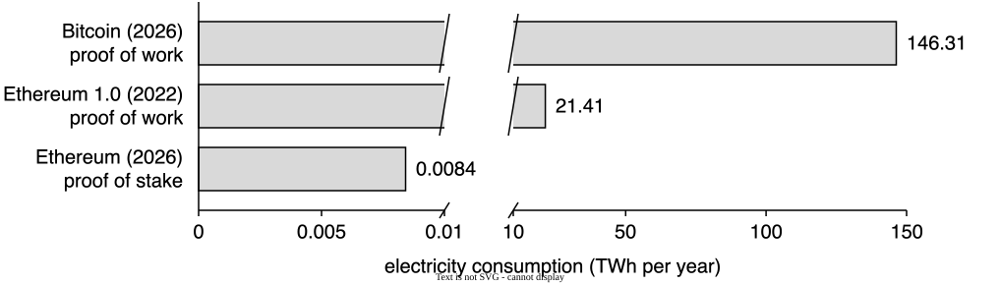

> [!note]
> Bitcoin and Ethereum 1.0 both used proof of work, but Bitcoin is a larger network: more computing power goes into mining, and thus more electricity.

---

> [!warning] The vicious cycle
> Mining needs computing power, and thus energy.
>
> ASICs supercharge mining, mining becomes more profitable, and more miners join the game. The more miners, the more computing power, and the cycle begins anew.
>
> More miners do not produce more blocks, because the [target space](bitcoin.md#51-hash-puzzles) is recalculated to keep one block every 10 minutes. The extra energy only buys more competition.

### 3.6. ASIC-resistant hash puzzles

Bitcoin is mostly mined with ASICs, which are thousands of times more efficient than general-purpose computers at solving [hash puzzles](bitcoin.md#51-hash-puzzles)

- Ordinary people are out of the game (high barrier to entry, which leads to centralization)
- Someone who discovered more efficient hardware might keep it secret to dominate the network

> [!info] ASIC-resistant hash puzzle
> A hash puzzle designed to reduce the gap between specialized and general-purpose hardware, so that ordinary people can mine (low barrier to entry, which leads to decentralization).

---

One way to resist ASICs is to make the hash puzzle memory hard, i.e., limited by the speed of memory rather than of the processor. Memory performance has improved much less than processor performance, so specialized hardware has little room to do better

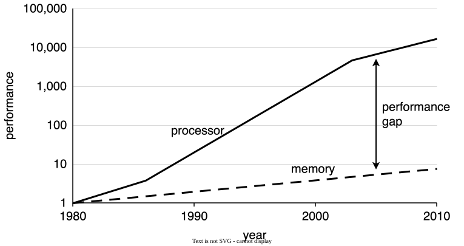

---

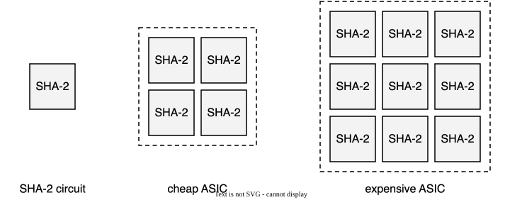

> [!warning] Secret hardware is unlikely
> An ASIC is just many copies of the same SHA-2 circuit, and a cheap and an expensive ASIC only differ in the number of copies.
>
> To mine faster, you need more copies, i.e., more money, not secret hardware. A breakthrough that computes proof of work much faster seems unlikely.

## 4. Wrap-up

### 4.1. What is a blockchain?

> [!info] Blockchain (non-technical)
> A [tamper evident](building-blocks.md#31-tamper-evident-logs) and [tamper resistant](bitcoin.md#33-double-spending) digital [ledger](building-blocks.md#11-ledgers) implemented in a [distributed fashion](bitcoin.md#2-the-bitcoin-network), usually [without a central authority](bitcoin.md#34-who-has-authority).
>
> A blockchain enables a community of users to record transactions in a shared ledger, such that, **under normal operation**, no transaction can be changed once published.

---

> [!info] Blockchain (technical)
> A [distributed](bitcoin.md#2-the-bitcoin-network) [ledger](building-blocks.md#11-ledgers) of [cryptographically signed](building-blocks.md#4-digital-signatures) transactions
> - Transactions are grouped into [blocks](bitcoin.md#13-bitcoins-ledger), and each block is linked to the previous one ([tamper evident](building-blocks.md#31-tamper-evident-logs))
> - As new blocks are added after [validation](bitcoin.md#22-simplified-consensus) and [consensus](building-blocks.md#5-consensus), older blocks become more difficult to modify ([tamper resistant](bitcoin.md#33-double-spending))
> - New blocks are [replicated](bitcoin.md#21-gossip-protocol) across copies of the ledger within the network, and conflicts are resolved automatically using [established rules](bitcoin.md#33-double-spending)

### 4.2. Permissionless and permissioned

|                                                                    | Permissionless                                                                                                                                                                                                                                          | Permissioned                                                                                                                                                                                                                                                                                                                    |
| ------------------------------------------------------------------ | ------------------------------------------------------------------------------------------------------------------------------------------------------------------------------------------------------------------------------------------------------- | ------------------------------------------------------------------------------------------------------------------------------------------------------------------------------------------------------------------------------------------------------------------------------------------------------------------------------- |
| Who can publish blocks                                             | Anyone                                                                                                                                                                                                                                                  | Only parties authorized by some authority                                                                                                                                                                                                                                                                                       |
| Who can read and write the [ledger](building-blocks.md#11-ledgers) | Anyone                                                                                                                                                                                                                                                  | A policy specifies who can read, write, or both                                                                                                                                                                                                                                                                                 |
| Consensus model                                                    | Requires expending resources ([proof of work](bitcoin.md#5-proof-of-work)) or maintaining resources ([proof of stake](#24-proof-of-stake)), and [rewards non-malicious behavior](bitcoin.md#4-incentives) with a native cryptocurrency (e.g., BTC, ETH) | Often [Byzantine fault tolerant](building-blocks.md#53-the-state-of-the-art-before-bitcoin). It often does not require the expense or maintenance of resources, because [the identities of the authorized parties are known](building-blocks.md#42-sybil-attacks), so it is typically faster and less computationally expensive |
| Software                                                           | Usually open source                                                                                                                                                                                                                                     | Both open source and closed source                                                                                                                                                                                                                                                                                              |

### 4.3. Consensus models

> [!info] Consensus model
> A process to achieve [agreement within a distributed system](building-blocks.md#52-the-consensus-problem) on the valid state.

> [!info] Proof of work
> A node [wins the right to publish the next block](bitcoin.md#52-mining) by expending time, energy, and computational cycles to solve [a problem that is hard to solve but easy to verify](bitcoin.md#51-hash-puzzles).

> [!info] Proof of stake
> Nodes lock an amount of cryptocurrency into the system ([stake](#24-proof-of-stake)). Nodes with more stake are more likely to want the system to succeed and not be subverted, so they get more weight during consensus.

## Glossary

| Term                                           | Meaning                                                                                                                                                                           |
| ---------------------------------------------- | --------------------------------------------------------------------------------------------------------------------------------------------------------------------------------- |
| ASIC (application-specific integrated circuit) | A chip designed for one task only, such as computing the hash puzzles of Bitcoin                                                                                                  |
| ASIC-resistant hash puzzle                     | A hash puzzle designed to reduce the gap between specialized and general-purpose hardware, so that ordinary people can mine                                                       |
| Base fee                                       | The amount of ETH per unit of gas set by the protocol, which is destroyed                                                                                                         |
| Blockchain                                     | A tamper evident and tamper resistant digital ledger implemented in a distributed fashion, usually without a central authority                                                    |
| Consensus model                                | A process to achieve agreement within a distributed system on the valid state                                                                                                     |
| Contract                                       | A promise or performance given in exchange for a promise or performance                                                                                                           |
| DAO (Decentralized Autonomous Organization)    | An organization managed entirely by smart contracts, with no direct human administration                                                                                          |
| Ether (ETH)                                    | The built-in currency of Ethereum                                                                                                                                                 |
| Ethereum 1.0                                   | Ethereum before the merge, when it used proof of work                                                                                                                             |
| Gas                                            | The unit that measures computation in Ethereum. Each instruction costs a fixed amount of gas                                                                                      |
| Hard fork                                      | A change to the rules of a blockchain that nodes running the old rules do not accept, so that the chain may split                                                                 |
| Memory-hard hash puzzle                        | A hash puzzle limited by how fast memory can be accessed rather than by how fast hashes can be computed                                                                           |
| Merge                                          | The switch of Ethereum from proof of work to proof of stake, on 15 September 2022                                                                                                 |
| Mining pool                                    | A group of miners that all contribute to the solution of hash puzzles and share the rewards in proportion to their contributions                                                  |
| Permissioned blockchain                        | A blockchain where only parties authorized by some authority can publish blocks                                                                                                   |
| Permissionless blockchain                      | A blockchain where anyone can publish blocks, without needing permission from any authority                                                                                       |
| Priority fee                                   | The amount of ETH per unit of gas that the sender offers to the node that proposes the block                                                                                      |
| Proof of stake                                 | A form of virtual mining. Nodes lock up (stake) ETH to get the right to propose blocks and vote on them. If they behave dishonestly, part of their stake is destroyed             |
| Re-entrant call                                | A call that runs a function again before its previous run is over                                                                                                                 |
| Selfish mining                                 | A strategy in which a mining pool keeps the blocks that it finds secret, and reveals them when the public chain approaches its private chain in length                            |
| Smart contract                                 | A set of promises, specified in digital form, including protocols within which the parties perform on these promises (Szabo). In Ethereum, a program that lives on the blockchain |
| Turing-complete machine                        | A machine that, given enough time and memory, can solve any computational problem                                                                                                 |
| Virtual mining                                 | Using the money that would have been spent on mining rigs directly within the system, without any computational work                                                              |
| Wei                                            | The smallest unit of ether, $1 \text{ ETH} = 10^{18}$ wei                                                                                                                         |
| Word                                           | A 256-bit (32-byte) piece of data, the unit that Ethereum computes with                                                                                                           |

## Bibliography

| Author(s)                                     | Title                                                                                                                                                                                             | Year |
| --------------------------------------------- | ------------------------------------------------------------------------------------------------------------------------------------------------------------------------------------------------- | ---- |
| Thompson, K.                                  | [Reflections on Trusting Trust](https://doi.org/10.1145/358198.358210)                                                                                                                            | 1984 |
| Szabo, N.                                     | [Smart Contracts: Building Blocks for Digital Markets](https://www.fon.hum.uva.nl/rob/Courses/InformationInSpeech/CDROM/Literature/LOTwinterschool2006/szabo.best.vwh.net/smart_contracts_2.html) | 1996 |
| Buterin, V.                                   | [Ethereum: A Next-Generation Smart Contract and Decentralized Application Platform](https://ethereum.org/whitepaper/)                                                                             | 2014 |
| Weaver, N.                                    | [Risks of Cryptocurrencies](https://doi.org/10.1145/3208095)                                                                                                                                      | 2018 |
| Eyal, I. and Sirer, E. G.                     | [Majority Is Not Enough: Bitcoin Mining Is Vulnerable](https://doi.org/10.1145/3212998)                                                                                                           | 2018 |
| Kugler, L.                                    | [Why Cryptocurrencies Use So Much Energy: And What to Do About It](https://doi.org/10.1145/3213762)                                                                                               | 2018 |
| Yaga, D., Mell, P., Roby, N. and Scarfone, K. | [Blockchain Technology Overview](https://doi.org/10.6028/NIST.IR.8202)                                                                                                                            | 2018 |
| Herlihy, M.                                   | [Blockchains from a Distributed Computing Perspective](https://doi.org/10.1145/3209623)                                                                                                           | 2019 |
| Waldo, J.                                     | [A Hitchhiker's Guide to the Blockchain Universe](https://doi.org/10.1145/3303868)                                                                                                                | 2019 |
| Wood, G.                                      | [Ethereum: A Secure Decentralised Generalised Transaction Ledger](https://ethereum.github.io/yellowpaper/paper.pdf)                                                                               | 2025 |
| Cambridge Centre for Alternative Finance      | [Cambridge Blockchain Network Sustainability Index](https://ccaf.io/cbnsi/cbeci)                                                                                                                  | 2026 |
| Community                                     | [Bitcoin Wiki: Laszlo Hanyecz](https://en.bitcoin.it/wiki/Laszlo_Hanyecz)                                                                                                                         | 2026 |

## Licenses

| Content | License                                                                                                                       |
| ------- | ----------------------------------------------------------------------------------------------------------------------------- |
| Code    | [MIT License](https://mit-license.org/)                                                                                       |
| Text    | [Creative Commons Attribution-NonCommercial-ShareAlike 4.0 International](https://creativecommons.org/licenses/by-nc-sa/4.0/) |
