# Bitcoin

## Table of contents

- [1. Ledger of transactions](#1-ledger-of-transactions)
    - [1.1. Account-based ledger](#11-account-based-ledger)
    - [1.2. Transaction-based ledger](#12-transaction-based-ledger)
    - [1.3. Bitcoin's ledger](#13-bitcoins-ledger)
- [2. The Bitcoin network](#2-the-bitcoin-network)
    - [2.1. Gossip protocol](#21-gossip-protocol)
    - [2.2. Simplified consensus](#22-simplified-consensus)
- [3. Attacks](#3-attacks)
    - [3.1. Stealing coins](#31-stealing-coins)
    - [3.2. Leaving transactions out](#32-leaving-transactions-out)
    - [3.3. Double spending](#33-double-spending)
    - [3.4. Who has authority?](#34-who-has-authority)
- [4. Incentives](#4-incentives)
    - [4.1. Honesty is problematic](#41-honesty-is-problematic)
    - [4.2. Block reward](#42-block-reward)
    - [4.3. Transaction fees](#43-transaction-fees)
- [5. Proof of work](#5-proof-of-work)
    - [5.1. Hash puzzles](#51-hash-puzzles)
    - [5.2. Mining](#52-mining)
    - [5.3. Alternatives](#53-alternatives)
- [Glossary](#glossary)
- [Bibliography](#bibliography)
- [Licenses](#licenses)

## 1. Ledger of transactions

A [ledger](building-blocks.md#11-ledgers) is a place to record all the transactions that happen in a system.

> [!info] Account-based ledger
> Every transaction moves coins from one account to another. Ethereum is an example.

> [!info] Transaction-based ledger
> There are no accounts. Every transaction consumes outputs of earlier transactions and creates new ones. Bitcoin is an example.

### 1.1. Account-based ledger

> [!example]
> Alice wants to transfer 15 coins to David.

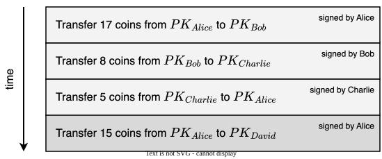

> [!question] Does Alice have the 15 coins that she is trying to transfer to David?

---

To find out, we can

> [!warning] Scan backwards every transaction that has ever involved Alice
> Not efficient at all.

> [!warning] Use a data structure to make it more efficient
> Requires extra housekeeping.

### 1.2. Transaction-based ledger

> [!example]
> Alice owns 25 coins and wants to pay 17 coins to Bob.

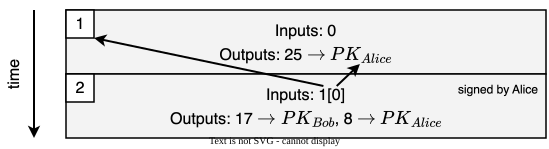

where

- Transaction 1 has no signature because it creates coins and sends them to Alice
- Transaction 2 has input `1[0]`, that is, output 0 of transaction 1 (inputs and outputs are defined as arrays)

Alice has to send coins to herself because there are no accounts here, so a transaction must spend its inputs entirely.

---

> [!example]
> Then, Alice wants to pay 6 coins to David.

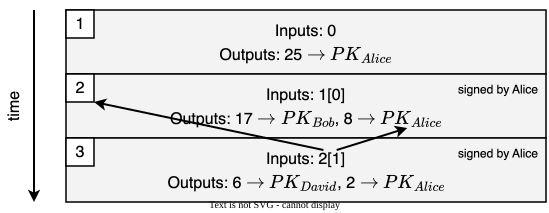

> [!question] Is transaction 3 valid?

---

> [!success] Transaction 3 is valid
> The input of transaction 3 is output 1 of transaction 2, which goes to Alice, and Alice signed transaction 3. To check this, we just follow one pointer. There is no need to scan backwards every transaction that has ever involved Alice.

> [!note]
> No extra data structure is needed: it is embedded in the ledger itself.

---

> [!example]
> Finally, David and Alice want to pay 8 coins to Carol together.

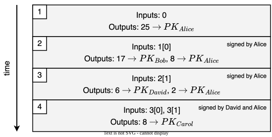

where

- Transaction 4 has inputs `3[0]` and `3[1]`, that is, outputs 0 and 1 of transaction 3
- Transaction 4 needs two signatures because the coins are owned by two different people

This is called a joint payment.

### 1.3. Bitcoin's ledger

Bitcoin's ledger of transactions is a [hash chain of blocks](building-blocks.md#31-tamper-evident-logs), with a [Merkle tree](building-blocks.md#32-merkle-trees) of transactions in each block

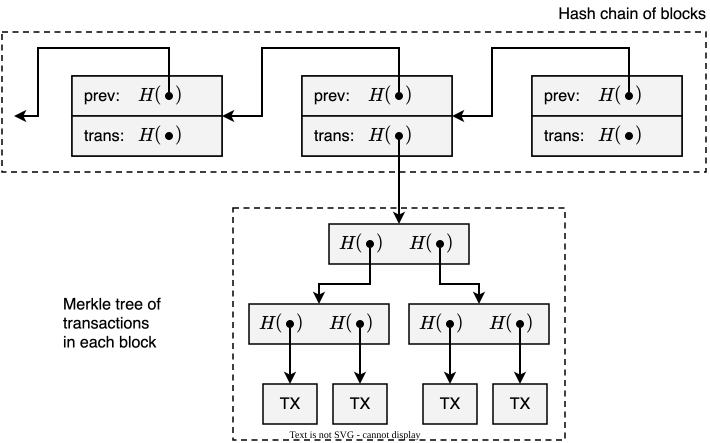

> [!question] Why bundle transactions together?

---

> [!success] Fewer rounds of consensus
> The nodes agree on a whole block of transactions at once, instead of one transaction at a time. This way, more transactions get into the ledger in the same amount of time.

> [!success] Shorter chain
> A hash chain of blocks is much shorter than a hash chain of transactions, so it is faster to verify.

## 2. The Bitcoin network

The Bitcoin network is an overlay peer-to-peer network over the Internet

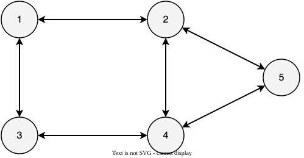

---

In the Bitcoin network

- The topology is not fully connected (scalability)
- All nodes are equal (peer-to-peer)
- New nodes can join at any time

The nodes maintain the ledger of transactions. Every node keeps a copy of the ledger, so the nodes must [agree](building-blocks.md#5-consensus) on which blocks of transactions to append to it (see [§1.3](#13-bitcoins-ledger)).

### 2.1. Gossip protocol

Alice, Bob, Carol, and David do not maintain the ledger. They are clients of the Bitcoin network.

When they want to publish a transaction, they submit it to a node. Then, the transaction spreads through the network with a gossip protocol.

> [!info] Gossip protocol (aka flooding)
> If you have news, tell as many people as you can. They will do the same, and so on.

---

> [!example]
> Alice wants to pay 17 coins to Bob. She submits the transaction to node 3.

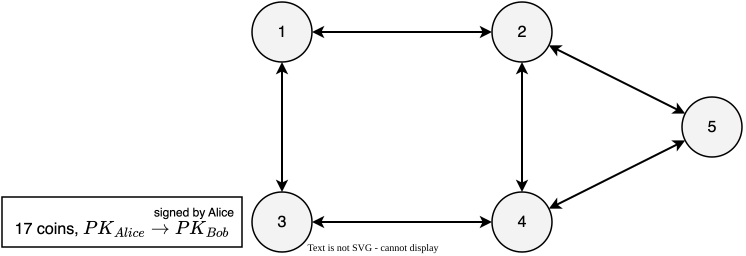

---

Node 3 broadcasts the transaction to its neighbors, nodes 1 and 4.

Nodes 1 and 4 add the transaction to their pool of pending transactions, that is, the list of transactions that a node has heard about, but that have not been put into the ledger yet.

---

The flooding eventually stops when every node has heard about the new transaction.

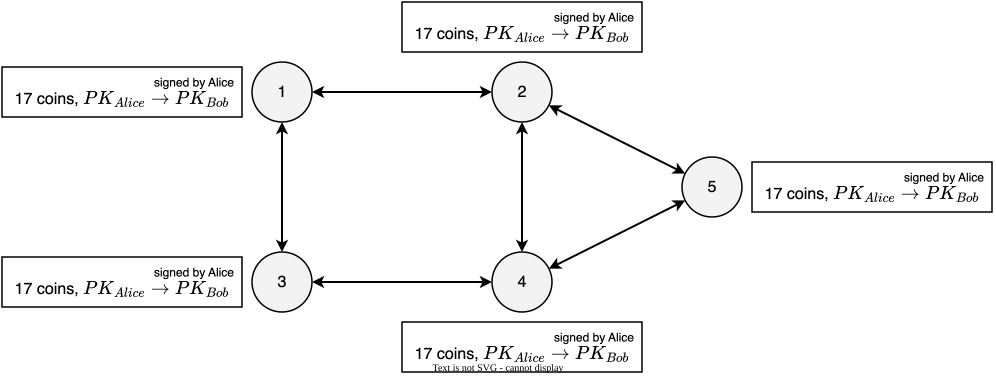

### 2.2. Simplified consensus

The consensus protocol of Bitcoin works as follows (simplified version)

1. New transactions are broadcast to all nodes
2. Each node collects new transactions into a block
3. In each round, a random node broadcasts its block
4. The other nodes accept that block if all the transactions in it are valid
    - No double spending
    - Valid signatures
5. Nodes express acceptance of the block by including its hash in the next block (see [§1.3](#13-bitcoins-ledger))

## 3. Attacks

### 3.1. Stealing coins

> [!example]
> Alice runs node 3, which is malicious. Alice creates a transaction that sends 10 coins from Bob to herself, and signs it herself. Node 3 accepts the transaction, even though the signature is not valid, and broadcasts it to its neighbors, nodes 1 and 4.

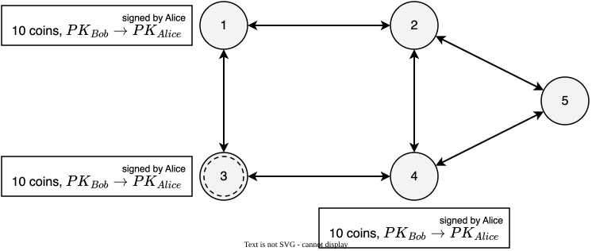

> [!question] Can Alice steal coins from Bob?

---

> [!success] No, as long as the cryptography is solid
> Only Bob can [sign](building-blocks.md#4-digital-signatures) a transaction that spends coins owned by Bob. The signature is not valid, so nodes 1 and 4 do not forward the transaction.

### 3.2. Leaving transactions out

> [!example]
> Then, Bob wants to pay 5 coins to Carol.
>
> Every node hears about the transaction and adds it to its pool of pending transactions:
> - Honest nodes 1, 2, 4, and 5 put the transaction into the block they would propose
> - Node 3, which Alice controls, leaves the transaction out on purpose

> [!question] What if node 3 gets to propose the next block?

---

> [!success] Bob just waits for the next block
> The transaction stays in the pool of pending transactions of the other nodes. Sooner or later, an honest node proposes a block that includes it.

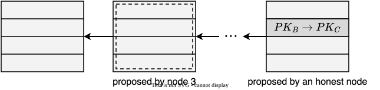

### 3.3. Double spending

> [!example]
> Bob sells software online and accepts payments in coins. Alice buys software from Bob for 10 coins. She submits the transaction to a node, an honest node puts it into a block, and that block gets into the ledger.

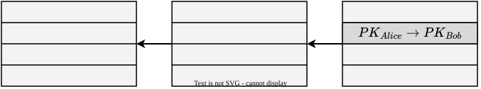

---

> [!example]
> Then, Bob sees the payment and naively lets Alice download the software.

If the next block happens to be proposed by Alice, she can attempt a [double-spending](building-blocks.md#13-the-double-spending-problem) attack

1. Create a new transaction that sends the same 10 coins to $PK_{Alice'}$, another public key that she owns
2. Put the new transaction into the block she proposes
3. Ignore the last block, so that her block points to the one before

---

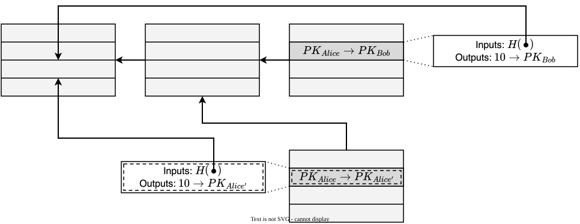

---

Whether the double-spending attack is going to succeed depends on which transaction ends up in the long-term consensus chain

> [!note]
> The long-term consensus chain is the chain that honest nodes eventually agree on. When the chain forks, honest nodes end up building on only one branch, and the blocks in the other branch are ignored.

This depends on how honest nodes behave

- Honest nodes always extend the longest chain (policy)
- When two branches are equally long, honest nodes extend the one they heard about first (heuristic)

---

> [!example]
> Then, the next node extends the "wrong" chain (the one with the transaction to $PK_{Alice'}$) because the node heard about that block first (heuristic).

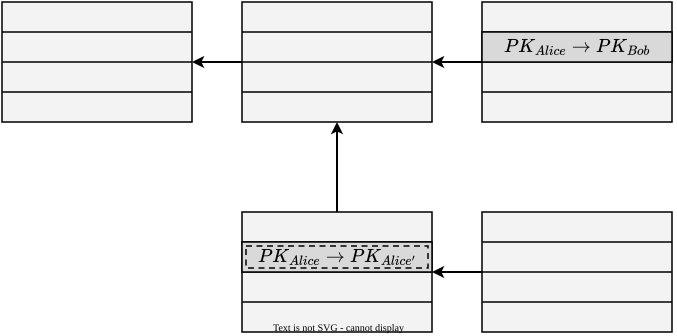

---

> [!example]
> Then, the next node extends the "wrong" chain again, which is now the longest chain (policy).

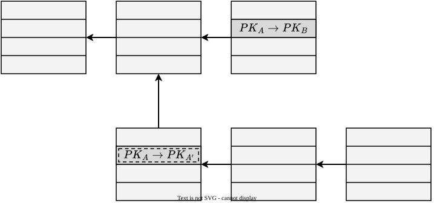

---

> [!example]
> Honest nodes keep extending the longest chain, so the faded block becomes a stale block. The transactions in that block are not part of the ledger: they are treated as if they never happened. In the end, Alice got the software for free.

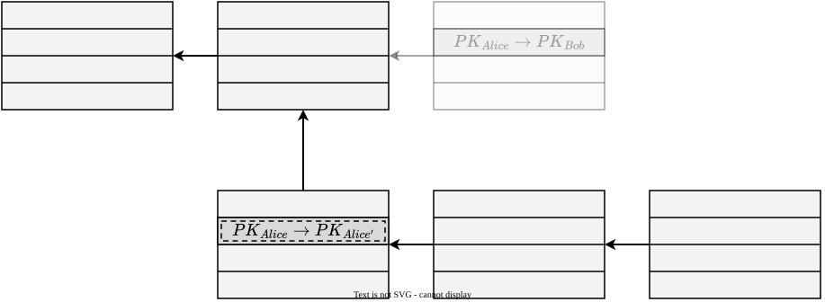

> [!question] How can Bob protect himself?

---

Bob can wait until the transaction gets enough confirmations

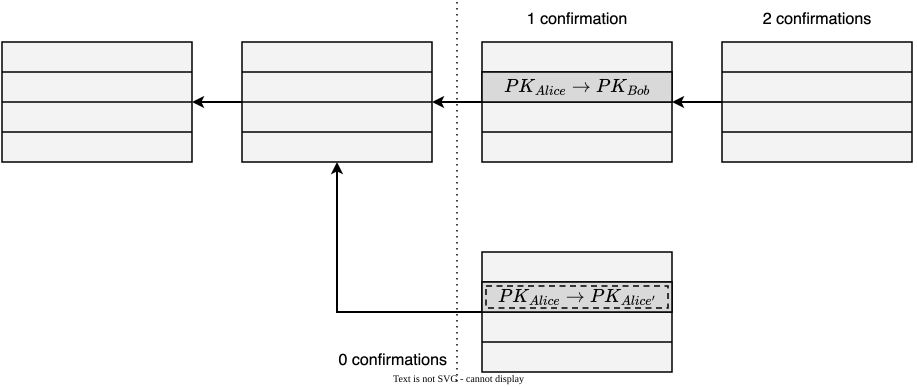

where

- 0 confirmations: Bob hears about the transaction
- 1 confirmation: the transaction is in a block
- 2 confirmations: another block extends the block with the transaction

> [!note]
> The probability of a double spend decreases exponentially with the number of confirmations. The most common heuristic is to wait for 6 confirmations.

### 3.4. Who has authority?

No single node has authority over which transactions are valid. Instead,

- Cryptography and consensus protect against invalid transactions
- Consensus protects against double spending

> [!warning] The guarantee is probabilistic
> There is no guarantee that a transaction ends up in the longest chain.

## 4. Incentives

### 4.1. Honesty is problematic

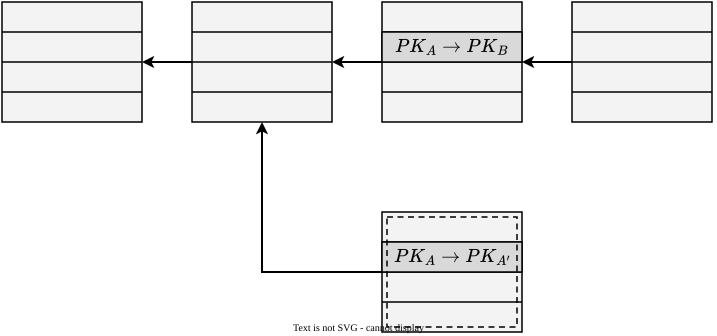

> [!question] Can we penalize the node that proposed the dashed block?

---

> [!failure] No, nodes do not have real identities
> A node is just a public key (see [public keys as identities](building-blocks.md#41-public-keys-as-identities)), and anyone can create a new one at any time (pseudonymity).
>
> Also, the protocol cannot take coins away from a public key: only the owner of the secret key can sign a transaction that spends them (see [§3.1](#31-stealing-coins)).

---

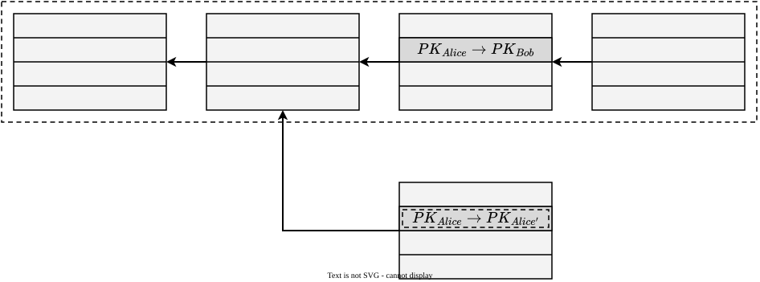

> [!question] Can we reward the nodes that contributed to the dashed chain?

---

> [!success] Yes, with a digital currency
> Nodes do not have real identities, but they have public keys, and coins can be sent to public keys.
>
> Bitcoin rewards the nodes that create blocks with its own coins. A node gets the reward only if its block ends up in the long-term consensus chain.
>
> This gives nodes an incentive to follow the protocol.

### 4.2. Block reward

The creator of a block includes a coinbase transaction (aka coin-creation transaction) in the block, which sends new coins to the creator

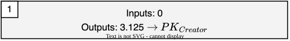

The creator actually gets the reward only if the block ends up in the long-term consensus chain. Otherwise, the block is a stale block, so the coinbase transaction is not part of the ledger and the creator gets nothing.

---

The block reward halves roughly every 4 years, that is, every 210,000 blocks

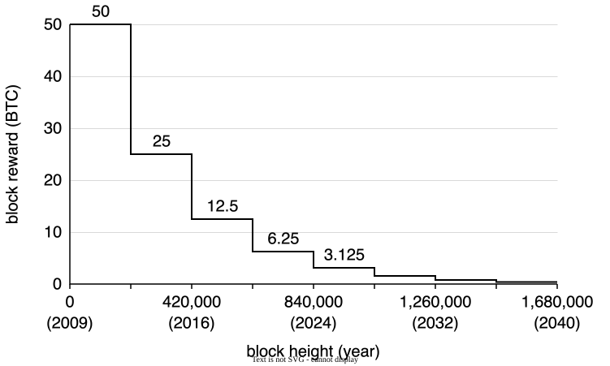

The last halving happened in April 2024, at block 840,000. Since then, the creator of a block gets 3.125 BTC. The next halving is expected in 2028, at block 1,050,000.

---

As a result, the supply of bitcoins is finite: it gets closer and closer to 21 million. New bitcoins will keep being created, in smaller and smaller amounts, until around 2140.

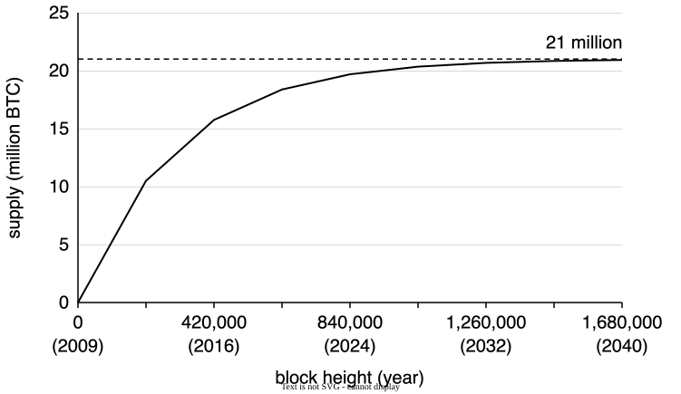

### 4.3. Transaction fees

The creator of a transaction can make the outputs smaller than the inputs. The difference goes to the creator of the block that includes the transaction.

Transaction fees are voluntary, like a tip.

> [!note]
> As the block reward runs out, fees are expected to become more and more important to get a transaction into a block in a reasonable time.

## 5. Proof of work

In the simplified consensus protocol (see [§2.2](#22-simplified-consensus)), a random node proposes the next block in each round (step 3). However, in Bitcoin

- There is no central authority
- Anyone can participate
- [Public keys work as identities](building-blocks.md#41-public-keys-as-identities)

> [!question] How to decide who is going to propose the next block?

---

> [!failure] Random choice
> This is not possible, because there is no central authority that could make the choice.
>
> Even if the nodes could agree on a random choice among themselves, it would still be a bad design choice.
>
> An attacker can participate in the system with many identities to be picked more often ([Sybil attack](building-blocks.md#42-sybil-attacks)).

---

> [!success] Choice weighted by computing power
> The more computing power a node has, the more likely it is to propose the next block. Creating many identities does not give more computing power, so Sybil attacks do not work.

> [!info] Proof of work
> Nodes compete with each other using their computing power to propose the next block.

> [!warning] Assumption
> Computing power is expected to be a resource that no one can monopolize. If someone did, they would propose most of the blocks, so they could control the network and subvert consensus.

### 5.1. Hash puzzles

To create a block, a node must find a nonce such that $H(nonce \mid prev \mid TX_1 \mid \dots \mid TX_N)$ falls within the target space

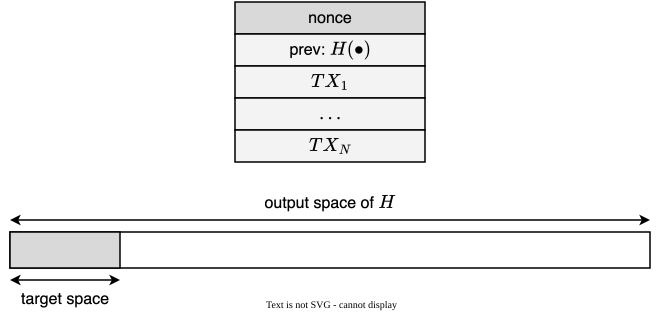

If the target space were just 1% of the output space, a node would have to try around 100 nonces before getting lucky.

---

The Bitcoin network computes around $10^{21}$ [hashes per second](https://mempool.space/graphs/mining/hashrate-difficulty) (November 2026).

The target space is recalculated every 2016 blocks (about 2 weeks), so that a new block is created every 10 minutes on average, to avoid inefficiencies.

The probability that someone creates the next block is the fraction of the global hash power that they control. For example, if Alice controls 0.1% of the global hash power, she creates about 1 in 1000 blocks.

### 5.2. Mining

> [!info] Mining and miners
> Mining is the process of solving hash puzzles. The nodes that do it are called miners. Miners compete all the time, independently, to solve hash puzzles. Once in a while, one of them gets lucky and finds a suitable nonce.

Mining is what actually happens at step 3 of the consensus protocol (see [§2.2](#22-simplified-consensus)). The protocol in §2.2 is simplified precisely because it assumes that someone can pick a random node.

---

> [!warning] Security assumption
> In a proof-of-work system, attacks become impractical if the majority of miners, weighted by hash power, are honest.

> [!note]
> If honest miners control the majority of the hash power, there is more than a 50% chance that the next block comes from an honest node.

### 5.3. Alternatives

Proof of work is not the only option. Other examples are

- Proof of stake
- Delegated proof of stake
- Proof of authority
- Proof of elapsed time

Ethereum is based on proof of stake.

## Glossary

| Term                                                 | Meaning                                                                                                                        |
| ---------------------------------------------------- | ------------------------------------------------------------------------------------------------------------------------------ |
| Account-based ledger                                 | A ledger in which every transaction moves coins from one account to another                                                    |
| Block                                                | A bundle of transactions that is appended to the ledger as a whole                                                             |
| Block height                                         | The position of a block in the chain, counting from 0 for the first block                                                      |
| Block reward                                         | The new coins that the creator of a block gets through the coinbase transaction                                                |
| Client                                               | A user who submits transactions to a node, without maintaining the ledger                                                      |
| Coinbase transaction (aka coin-creation transaction) | The transaction in a block that creates new coins and sends them to the creator of the block                                   |
| Confirmations                                        | The number of blocks from the block that includes a transaction to the end of the chain, both included                         |
| Double-spending attack                               | An attack in which someone spends the same coins twice by getting a conflicting transaction into the long-term consensus chain |
| Gossip protocol (aka flooding)                       | A protocol in which every node that has news tells as many other nodes as it can, which do the same, and so on                 |
| Halving                                              | The event, every 210,000 blocks, in which the block reward is cut in half                                                      |
| Hash power (aka hash rate)                           | The number of hashes that a node, or the whole network, computes per second                                                    |
| Hash puzzle                                          | The problem of finding a nonce such that the hash of a block falls within the target space                                     |
| Joint payment                                        | A transaction whose inputs are owned by different people, each of whom must sign it                                            |
| Long-term consensus chain                            | The chain that honest nodes eventually agree on                                                                                |
| Mining                                               | The process of solving hash puzzles to create blocks                                                                           |
| Nonce                                                | A number in a block that a miner changes freely to solve the hash puzzle                                                       |
| Overlay network                                      | A network built on top of another network, such as the Internet                                                                |
| Pool of pending transactions (aka mempool)           | The list of transactions that a node has heard about, but that have not been put into the ledger yet                           |
| Proof of work                                        | A way to pick nodes in proportion to their computing power, by making them solve hash puzzles                                  |
| Stale block (aka orphan block)                       | A valid block that is not part of the longest chain                                                                            |
| Target space                                         | The part of the output space of the hash function that a block hash must fall within                                           |
| Transaction fee                                      | The difference between the inputs and the outputs of a transaction, which goes to the creator of the block                     |
| Transaction-based ledger                             | A ledger with no accounts, in which every transaction consumes outputs of earlier transactions and creates new ones            |

## Bibliography

| Author(s)                   | Title                                                                             | Year |
| --------------------------- | --------------------------------------------------------------------------------- | ---- |
| Nakamoto, S.                | [Bitcoin: A Peer-to-Peer Electronic Cash System](https://bitcoin.org/bitcoin.pdf) | 2008 |
| Brownworth, A.              | [Blockchain Demo](https://andersbrownworth.com/blockchain/)                       | 2016 |
| Narayanan, A. and Clark, J. | [Bitcoin's Academic Pedigree](https://doi.org/10.1145/3132259)                    | 2017 |
| Community                   | [Bitcoin Wiki](https://en.bitcoin.it/wiki/Main_Page)                              | 2026 |

## Licenses

| Content | License                                                                                                                       |
| ------- | ----------------------------------------------------------------------------------------------------------------------------- |
| Code    | [MIT License](https://mit-license.org/)                                                                                       |
| Text    | [Creative Commons Attribution-NonCommercial-ShareAlike 4.0 International](https://creativecommons.org/licenses/by-nc-sa/4.0/) |
