# Building blocks

## Table of contents

- [1. Motivations](#1-motivations)
    - [1.1. Ledgers](#11-ledgers)
    - [1.2. Trusted third parties](#12-trusted-third-parties)
    - [1.3. The double-spending problem](#13-the-double-spending-problem)
    - [1.4. Nakamoto's ambition](#14-nakamotos-ambition)
- [2. Hash functions](#2-hash-functions)
    - [2.1. Security properties](#21-security-properties)
- [3. Hash pointers](#3-hash-pointers)
    - [3.1. Tamper-evident logs](#31-tamper-evident-logs)
    - [3.2. Merkle trees](#32-merkle-trees)
- [4. Digital signatures](#4-digital-signatures)
    - [4.1. Public keys as identities](#41-public-keys-as-identities)
    - [4.2. Sybil attacks](#42-sybil-attacks)
- [5. Consensus](#5-consensus)
    - [5.1. Motivating application](#51-motivating-application)
    - [5.2. The consensus problem](#52-the-consensus-problem)
    - [5.3. The state of the art before Bitcoin](#53-the-state-of-the-art-before-bitcoin)
- [Glossary](#glossary)
- [Bibliography](#bibliography)
- [Licenses](#licenses)

## 1. Motivations

### 1.1. Ledgers

A ledger is a place to record all the transactions that happen in a system.

Beyond accounting, ledgers confirm

- Ownership (e.g., property registers)
- Identity (e.g., civil registries)
- Status (e.g., marriage registers)
- Authority (e.g., registers granting patents or voting rights)

---

In 1494, Luca Pacioli published the first systematic description of the double-entry bookkeeping system. Every entry is recorded in at least two accounts, as a debit in one and a credit in another, and debits must equal credits.

For example, if Alice sends Bob USD 100, the ledger records

| Account | Debit   | Credit  |
| ------- | ------- | ------- |
| Alice   | USD 100 |         |
| Bob     |         | USD 100 |

### 1.2. Trusted third parties

Financial institutions act as trusted third parties to process electronic payments. These institutions

- Prevent double spending (see [§1.3](#13-the-double-spending-problem))
- Are a single point of failure
- Mediate disputes
    - Irreversible transactions are not really possible
    - Mediation comes with a cost

### 1.3. The double-spending problem

With the click of a button, any digital object can be copied.

Nobody wants a monetary system in which anyone can duplicate their money at will.

> [!question] Double-spending problem
> How can a receiver of digital money be sure that the money they were sent was not simultaneously sent to someone else?

### 1.4. Nakamoto's ambition

In 2008, Satoshi Nakamoto (whoever they may be) proposed a peer-to-peer electronic cash system based on cryptographic proof instead of trust that solves the double-spending problem. In this system

- Any two willing parties can transact directly with one another
- Transactions are computationally impractical to reverse

Bitcoin was the first cryptocurrency to use a blockchain. But the ideas behind blockchains had been around for decades...

## 2. Hash functions

Hash functions take any string as input, return a fixed-size string as output, and are fast to compute. For example, if $H$ is SHA-256

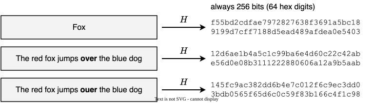

### 2.1. Security properties

> [!info] Collision resistance
> Nobody can find values $x$ and $y$ such that $x \neq y$ and $H(x) = H(y)$.

Since there are more possible inputs (strings of any size) than outputs (strings of a given length, say 256 bits), collisions do exist. If you try $2^{130}$ random inputs, then the chance that two of them collide is $\approx 100\%$. Yet, even if every computer ever made by humanity were computing hashes, it would take billions of years to have a realistic chance of finding a collision.

Therefore, if $H(x) = H(y)$, then it is safe to assume that $x = y$.

---

> [!info] Hiding (simplified)
> Given $H(x)$, it is infeasible to find $x$.

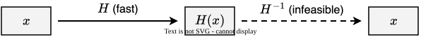

> [!warning]
> Hiding holds only if $x$ is hard to guess. If $x$ comes from a small set of values, say `yes` or `no`, anyone can hash every value and compare the results with $H(x)$.

---

> [!info] Puzzle friendliness (simplified)
> There is no solving strategy that is more effective than simply trying random values from a set of possible solutions until one of them works.

Suppose you need an $x$ whose $H(x)$ meets some target. For example, $H(x)$ must start with `000`. The only way is to try one input after another until one works. Trying `Fox 1`, `Fox 2`, and so on, the first hash that starts with `000` comes from `Fox 11667`

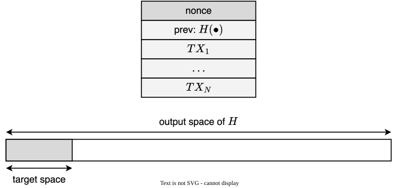

## 3. Hash pointers

> [!info] Hash pointer
> A hash pointer is
>
> - A pointer to where the data are stored
> - A hash of the data

If we have a hash pointer, we can

- Get the data back (this is what any pointer does)
- Verify that the data have not changed (this is because of the hash)

### 3.1. Tamper-evident logs

Just like a regular linked list, we can build a list of blocks, where each block has some data and a hash pointer to the previous block. A use case for this data structure is a tamper-evident log.

If we just remember the head of this data structure, we can detect any change an adversary might make in earlier blocks

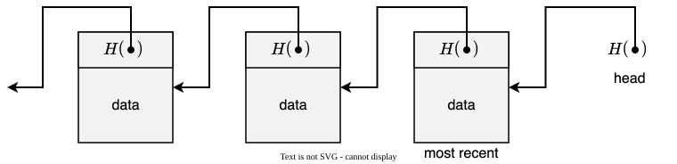

---

Let us assume an adversary tampers with the data of a block

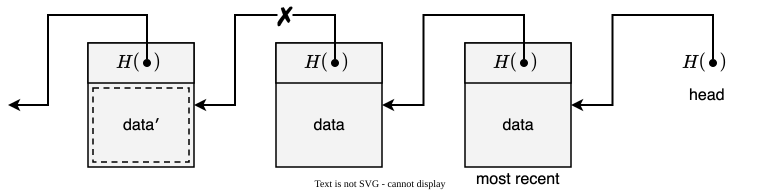

The hash of the data will be different. Since $H$ is collision-resistant, we can detect that someone changed something.

---

Let us assume the adversary also tampers with the hash pointer of the next block to reflect the change in the previous block

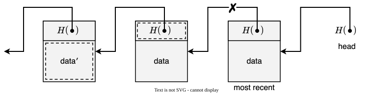

Again, we can detect that something is not as expected from the hash pointer of the next block.

---

Let us assume the adversary keeps going, up to the most recent block

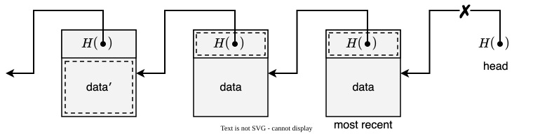

We can detect that something is not as expected from the head. The adversary cannot tamper with it because it is what we remembered in the first place.

### 3.2. Merkle trees

> [!info] Merkle tree
> A binary tree with hash pointers.

Merkle trees are named after Ralph Merkle, who invented them. They have the following characteristics

- Tamper-evident
- Membership verification in logarithmic time
- If sorted, non-membership verification

---

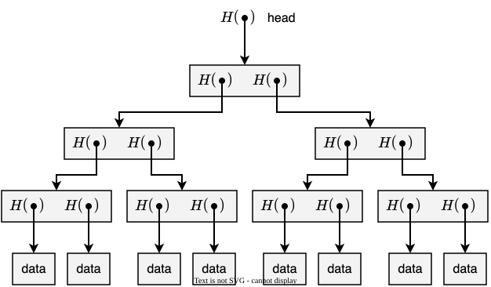

---

Suppose someone wants to prove that a data block is in the tree. We just remember the head, as in the previous example. Then, they only need to send us the data block and the sibling hashes along the path to the root

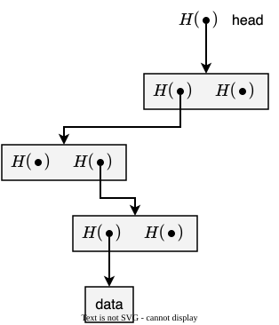

With 8 data blocks, the proof needs 3 sibling hashes. In general, with $n$ data blocks, it needs about $\log_2 n$ hashes.

---

In a sorted Merkle tree, the data blocks are kept in an agreed order, for example in numeric order

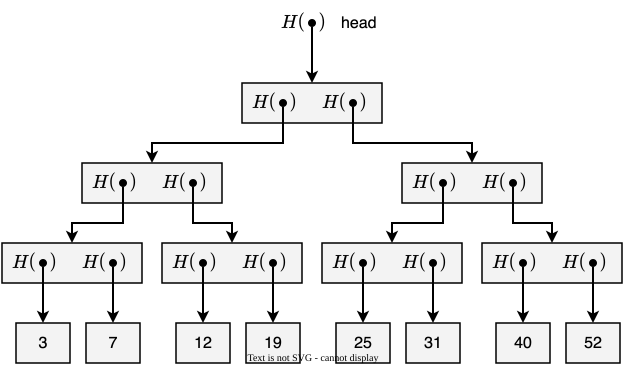

---

To prove that a data block is not in the tree, show the paths to the data blocks just before and just after it. For example, to prove that 20 is not in the tree, show the paths to 19 and 25

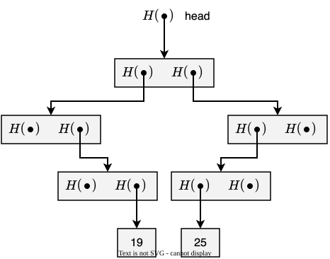

## 4. Digital signatures

We want digital signatures to satisfy two properties

- Only you can sign, but anyone can verify
- No one can copy-and-paste your signature to another document

Digital signatures are built on public key (or asymmetric) cryptography.

Each user generates a pair of keys: a secret key (also called private key), which they keep to themselves, and a public key, which they share with everyone. You sign with your secret key, and anyone can verify with your public key.

---

In code

```python
sk, pk = generate_keys(key_size)
signature = sign(sk, message)
is_valid = verify(pk, signature, message)
```

where

- `sk` is the secret signing key (to be kept secret)
- `pk` is the public verification key (publicly available)

---

To create a new identity, just generate a new key pair

```python
sk, pk = generate_keys(key_size)
```

where

- `pk` is the public name (or address) you use
- `sk` lets you speak for `pk`

### 4.1. Public keys as identities

Typically, the identity is either `pk` or a hash of `pk`.

Public keys as identities give pseudonymity: nobody forces users to disclose real-life information.

> [!warning]
> Pseudonymity is not anonymity. In a public ledger, everything signed with `sk` is visible to everyone and linked to `pk`. If someone ties `pk` to your real identity, they learn everything you have ever signed with it.

---

Think of `verify(pk, signature, message)` as "`pk` says `message`".

To speak for `pk`, you must know `sk`. Who controls `sk` controls the identity.

> [!warning]
> If you lose `sk`, you lose the identity: there is no way to recover `sk`, and nobody can speak for `pk` anymore. If someone steals `sk`, they can speak for `pk` as if they were you.

### 4.2. Sybil attacks

In peer-to-peer systems, there is no central authority to give identities to nodes. Creating an identity just takes a call to `generate_keys` (see [§4](#4-digital-signatures)), which is free, fast, and requires no permission.

> [!warning]
> Users can create as many identities as they want.

> [!info] Sybil attack
> An adversary creates many identities to look like many different participants, when in fact they are all controlled by the same adversary.

## 5. Consensus

A distributed system consists of a collection of distinct processes (or nodes) that

- Are spatially separated
- Communicate with one another by exchanging messages

In particular, a system is distributed if the message transmission delay is not negligible compared to the time between events in a single process.

Consensus is how the nodes of a distributed system come to agree on a single value.

### 5.1. Motivating application

> [!example]
> A distributed database records what happens on a social network. A new comment comes in.

> [!question] What could happen to the copies of the database?
> - Some of the copies record the comment, others do not
> - All of the copies record the comment
> - None of the copies record the comment

---

> [!failure] Some of the copies record the comment, others do not
> Must not happen. If it does, some users see the comment and others do not, depending on which copy of the database they read from.

> [!success] All of the copies record the comment
> OK. Every user sees the new comment.

> [!success] None of the copies record the comment
> Still OK. Nobody sees the new comment, but everyone has the same, consistent view of the system.

### 5.2. The consensus problem

Consider a distributed system with $N$ nodes, each with an input value. A consensus protocol must ensure that

- All correct nodes eventually decide
- All correct nodes decide on the same value
- If all correct nodes propose the same value, that value is chosen

Nodes that are not correct might be faulty or even malicious.

---

> [!example]
> There are 3 correct nodes in the system, and they have already agreed on a distributed data structure

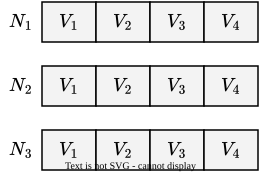

---

> [!example]
> Then, $N_1$, $N_2$, and $N_3$ propose a value, broadcasting it to the others

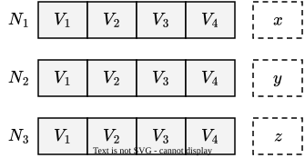

---

> [!example]
> The nodes agree on $y$, which becomes $V_5$

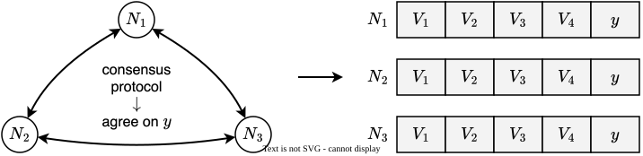

---

> [!warning] What could possibly go wrong?
> - Nodes may crash
> - Nodes may be malicious
> - The network may get partitioned, that is, some nodes cannot reach some others
> - Messages may be delayed
>     - Connections can be slow
>     - Latency is not negligible
> - There is no notion of global time

### 5.3. The state of the art before Bitcoin

There are many impossibility results. Two of the best known are

> [!info] Byzantine generals problem
> Nodes (generals) must agree on a plan, but some of them are malicious (traitors). With reliable, synchronous communication and unsigned messages, agreement is impossible when a third or more of the nodes are malicious.

> [!info] Fischer-Lynch-Paterson impossibility result
> In an asynchronous system, no deterministic protocol can guarantee consensus if even a single node may crash.

A few tried anyway, making compromises. For example, Paxos never produces an inconsistent result under crash failures, but it might fail to make any progress.

## Glossary

| Term                                                  | Meaning                                                                                                                                                 |
| ----------------------------------------------------- | ------------------------------------------------------------------------------------------------------------------------------------------------------- |
| Asynchronous system                                   | A distributed system in which there is no bound on how long messages take to be delivered or how long nodes take to process them                        |
| Collision                                             | Two different inputs with the same hash                                                                                                                 |
| Collision resistance                                  | A property of hash functions for which nobody can find two different inputs with the same hash                                                          |
| Consensus protocol                                    | A protocol that lets the nodes of a distributed system agree on a single value                                                                          |
| Correct node                                          | A node that is neither faulty nor malicious                                                                                                             |
| Deterministic protocol                                | A protocol in which what a node does next depends only on its current state and on the messages it has received                                         |
| Digital signature                                     | A value computed from a message and a secret key, which anyone can verify with the corresponding public key                                             |
| Distributed system                                    | A collection of distinct processes that are spatially separated and communicate with one another by exchanging messages                                 |
| Double-entry bookkeeping                              | An accounting system in which every entry is recorded in at least two accounts, as a debit in one and a credit in another. Debits must equal credits    |
| Double-spending problem                               | The problem of making sure that the same digital money is not spent more than once                                                                      |
| Hash (aka digest, checksum, or fingerprint)           | The output value of a hash function                                                                                                                     |
| Hash function                                         | A function that accepts input data of any length and generates a fixed-length value that is somehow derived from that data                              |
| Hash pointer                                          | A pointer to where some data are stored, together with a hash of the data                                                                               |
| Hiding                                                | A property of hash functions for which, given a hash, it is infeasible to find the input                                                                |
| Key pair                                              | A secret key and the corresponding public key                                                                                                           |
| Ledger                                                | A place to record all the transactions that happen in a system                                                                                          |
| Merkle tree                                           | A binary tree with hash pointers                                                                                                                        |
| Network partition                                     | A network failure that splits the nodes into groups that cannot reach each other                                                                        |
| Peer-to-peer system                                   | A distributed system in which nodes interact directly with one another, without a central authority                                                     |
| Pseudonymity                                          | The use of an identity that is not linked to real-life information                                                                                      |
| Public key                                            | A cryptographic key that can be shared openly and is used to verify digital signatures. In peer-to-peer systems, it also serves as an identity          |
| Public key cryptography (aka asymmetric cryptography) | A form of cryptography that uses a pair of keys, a secret key and the corresponding public key                                                          |
| Puzzle friendliness                                   | A property of hash functions for which there is no solving strategy more effective than trying random inputs until one of them works                    |
| Secret key (aka private key)                          | A cryptographic key that is kept secret and is used to create digital signatures                                                                        |
| Secure Hash Algorithm 256 (SHA-256)                   | A hash function that generates 256-bit hashes                                                                                                           |
| Single point of failure                               | A part of a system that, if it fails, stops the entire system from working                                                                              |
| Sorted Merkle tree                                    | A Merkle tree whose data blocks are kept in an agreed order                                                                                             |
| Sybil attack                                          | An attack in which an adversary creates many identities to look like many different participants                                                        |
| Tamper-evident log                                    | A list of blocks, where each block has some data and a hash pointer to the previous block. Any change to an earlier block can be detected from the head |
| Trusted third party                                   | An entity that two parties both trust to mediate their interactions, such as a bank processing an electronic payment                                    |

## Bibliography

| Author(s)                   | Title                                                                                                     | Year |
| --------------------------- | --------------------------------------------------------------------------------------------------------- | ---- |
| Lamport, L.                 | [Time, Clocks, and the Ordering of Events in a Distributed System](https://doi.org/10.1145/359545.359563) | 1978 |
| Merkle, R.                  | [Protocols for Public Key Cryptosystems](https://doi.org/10.1109/SP.1980.10006)                           | 1980 |
| Lamport, L. et al.          | [The Byzantine Generals Problem](https://doi.org/10.1145/357172.357176)                                   | 1982 |
| Fischer, M. et al.          | [Impossibility of Distributed Consensus with One Faulty Process](https://doi.org/10.1145/3149.214121)     | 1985 |
| Haber, S. and Stornetta, W. | [How to Time-Stamp a Digital Document](https://doi.org/10.1007/BF00196791)                                | 1991 |
| Lamport, L.                 | [The Part-Time Parliament](https://doi.org/10.1145/279227.279229)                                         | 1998 |
| Douceur, J.                 | [The Sybil Attack](https://doi.org/10.1007/3-540-45748-8_24)                                              | 2002 |
| Nakamoto, S.                | [Bitcoin: A Peer-to-Peer Electronic Cash System](https://bitcoin.org/bitcoin.pdf)                         | 2008 |
| Narayanan, A. and Clark, J. | [Bitcoin's Academic Pedigree](https://doi.org/10.1145/3132259)                                            | 2017 |

## Licenses

| Content | License                                                                                                                       |
| ------- | ----------------------------------------------------------------------------------------------------------------------------- |
| Code    | [MIT License](https://mit-license.org/)                                                                                       |
| Text    | [Creative Commons Attribution-NonCommercial-ShareAlike 4.0 International](https://creativecommons.org/licenses/by-nc-sa/4.0/) |
